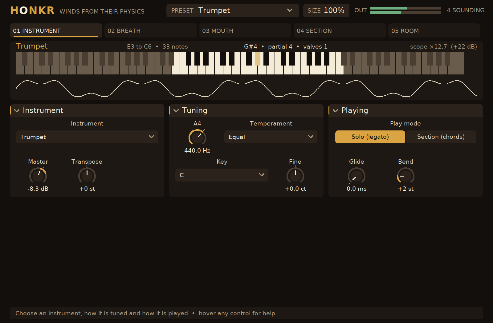

# HONKR — wind instruments from their physics

Every page: [INSTRUMENT](docs/screenshots/page1.png), [BREATH](docs/screenshots/page2.png),
[MOUTH](docs/screenshots/page3.png), [SECTION](docs/screenshots/page4.png), [ROOM](docs/screenshots/page5.png),
and the [preset menu](docs/screenshots/presets.png).

HONKR is a cross-platform CLAP instrument that simulates wind instruments from their physics
rather than playing samples of them: reeds, brass, flutes, pipes and horns. It builds on Linux,
Windows and macOS with a native editor on all three (X11, Win32, Cocoa). It follows the model of
[SCHRODR](https://github.com/andrewfader/schrodr), [FUZZBOI](https://github.com/andrewfader/fuzzboi)
and [YANES](https://github.com/andrewfader/yanes): a header-only physics engine, a thin CLAP shell,
a native editor, and a suite that proves every claim from the audio in the unit the claim is made in.

## What is in it

**Twenty-seven instruments**, every one a sound-producing loop: a valve or a jet at the mouthpiece
driving the air column of the bore (a digital waveguide), which returns its wave a round trip later
and radiates the rest from the bell.

| Instruments | What is simulated |
|---|---|
| Clarinet, bass clarinet | a cane reed beating against the lay on a cylinder closed at the reed, the bore given as its resonances (a modal bore, fitted to recordings): Bernoulli flow through the reed's opening, the reed a mass on a spring, the mouthpiece's pressure solved exactly each sample. Odd harmonics; the note starts above a third of the reed's closing pressure (higher with the bore's losses) |
| Soprano, alto, tenor and baritone saxophones; bassoon | the same reed on a cone given as its resonances, every harmonic, fitted to recordings. The bassoon's double reed is stiffer, with strong nasal formants |
| Oboe | a double reed on a cone waveguide, the wave running to the bell and to the missing apex: every harmonic, stiffer and brighter, with strong nasal formants |
| Highland bagpipe | the chanter's nine notes (low G to high A, with C# and F#), un-tongued, and three cylindrical-reed drones (a bass on A2 and two tenors on A3) that sound while the bag is squeezed |
| Flute, piccolo, alto flute, recorder, tin whistle, shakuhachi | an air jet across an edge, bent by the flow in the mouth and switching into or out of the pipe a travel time later. Blow harder and the pitch rises; shorten the jet and the pipe overblows to its octave |
| Pan flute | the same jet over a stopped pipe: the hollow odd-harmonic tone |
| Ocarina | the jet over a Helmholtz resonator: one mode, nearly a pure sine, and as breath-sensitive as the real thing |
| Trumpet, flugelhorn, French horn, euphonium, tuba | the player's lips, an outward-striking valve with their own resonance, choosing a partial of the bore's harmonic series. Valves add their crooks of tubing, which come up short when pressed together (1+3 about 30 cents sharp, 1+2+3 about 50); a fourth valve; a double horn's thumb valve to the B-flat side. Loud notes blare: the wave steepens toward a shock on its way down the bore |
| Trombone | the slide's seven positions, in tune, and the F trigger for the gap below the second partial; glissando through the glide |
| Bugle, alphorn, shofar | natural horns: only the harmonic series. A key plays the partial nearest it; un-lipped, the alphorn's 11th partial is its famous "fa", a quarter-tone over the fourth, and the shofar's partials are stretched |
| Didgeridoo | the lips on a cone, a drone with the player's throat shaping vowels over it |

**The player**: the breath from velocity or from a breath controller (CC 2), expression (CC 11), the
mod wheel or key pressure, held for the note's whole length, so a note can swell and fade; the
breath against the instrument's own pressure (under its threshold it will not speak; far over,
reeds choke, flutes overblow and brass blare); attack, release and the tongue's attack; breath
noise; growl and flutter-tonguing; the reed's strength; the embouchure; the lips' tension (far
enough and the horn cracks to the next partial); lipping (how far the player bends the horn's own
intonation to the tempered scale); mutes (straight, cup, Harmon, bucket) and the hand in the bell
or a plunger; the keys' and valves' clicks; vibrato with its depth, rate and delay, made by the jaw,
the lips or (on a flute) the breath. **Solo** play slurs from note to note without a new tongue, as a
wind player does (last note held wins); **Section** play gives each key its own player, for chords.
Up to four players double each note, tuned a few cents apart and entering a few milliseconds
apart, seated across the stereo picture.

**The tuner's work**: six temperaments (equal, Pythagorean, quarter-comma meantone,
Werckmeister III, Kirnberger III, Vallotti) from any key, the reference pitch from 392 to 466 Hz,
and a fine tune. Every instrument is calibrated once per sample rate: the loop's filters' delay is
computed exactly and what the reed, lips or jet pull is measured, so each note sounds where it is
fingered (held by `horn_tests` to within 25 cents across every compass at mezzo-forte).

**The room and its air**: every instrument plays into a room and is heard through air (ISO
9613-1 absorption, the speed of sound, image-source reflections, a Sabine tail) by an omni,
cardioid or figure-8 microphone, as a stereo pair or one mono mic.

**Sixty-four presets**, from "Alto sax", "Smoky tenor" and "Honking R&B tenor" through "Klezmer
clarinet", "Oboe, baroque", "Highland pipes", "Breathy flute", "Shakuhachi" and "Ocarina" to
"Trumpet, Harmon mute", "Lead trumpet, screaming", "Horn, stopped", "Trombone glissando",
"Oompah tuba", "Alphorn, its own fa", "Shofar", "Didgeridoo, wah", "Big band trumpets" and presets
for breath controllers; all measured against the [quality bar](docs/QUALITY.md) by
`build/honkr-preset-audit` and held to it by the test suite.

Notes beyond an instrument's compass sound an octave inside it. CLAP and MIDI note dialects,
sample-accurate events, parameter modulation, state with the editor's size.

See [docs/PHYSICS.md](docs/PHYSICS.md) for what is simulated, how it is measured, and what is not.

## Building

Requirements: CMake 3.20+, a C++20 compiler, and on Linux `libx11-dev`, `libxft-dev` and
`pkg-config` (plus DejaVu fonts at run time). The CLAP headers are fetched at configure time,
pinned by tag.

    cmake -S . -B build -G Ninja -DCMAKE_BUILD_TYPE=Release
    cmake --build build
    ctest --test-dir build --output-on-failure
    cmake --install build --prefix ~/.local      # puts HONKR.clap in ~/.local/clap

Offline, point the fetch at an existing checkout:

    cmake -S . -B build -DFETCHCONTENT_SOURCE_DIR_CLAP=/path/to/clap

`-DHONKR_EDITOR=OFF` builds without the native editor (the host's generic panel still works);
`-DHONKR_COVERAGE=ON` instruments the tests for `tools/coverage.py`.

## How it is tested

Every suite is a plain executable with Given/When/Then scenarios (`tests/spec.hpp`); the
`features/` directory maps each scenario to its test. Nothing depends on a display, audio
hardware, installed plug-ins or the network.

| Suite | Proves |
|---|---|
| `dsp_tests` | the temperaments against the treatises, the limiter, the filters |
| `horn_tests` | the loop's physics: a cylinder's odd harmonics, the reed's threshold, a cone's full harmonic series, the lips choosing partials, the valves' arithmetic, the jet overblowing, the stopped pipe and the vessel, brass blaring, the filters' exact delay, every instrument in tune across its compass |
| `winds_tests` | fingering (the trumpet's chart, lipping against the horn's own intonation, the trombone's slide and trigger, the double horn, natural horns, the chanter), the compass, solo slurs, sections and unisons, breath from a controller, the drones |
| `air_tests` | the room and its air against the physics: the speed of sound, ISO 9613-1, Sabine's time |
| `engine_tests` | notes, breath controllers, dynamics, the instrument switch, the wheels, every instrument at a comparable level, every preset against the quality bar, the limiter, the tail |
| `reference_tests` | every note of 35 recordings of the real instruments (University of Iowa, 12 instruments, pp/mf/ff) replayed through HONKR; no instrument may match them worse than `references/baseline.tsv` (see [references/README.md](references/README.md)) |
| `plugin_smoke`, `note_tests`, `state_tests` | the built `.clap` through the public CLAP ABI: discovery, ports, parameters, events at sample offsets, MIDI, presets, state round trips, malformed state |
| `advertised_tests` | one proof per parameter from audio; fails if a parameter has no proof |
| `ui_tests` | the real page table and editor against a fake host that enforces gesture rules and a canvas that records drawing |
| `frontend_tests` (Linux) | the plug-in side of the editor: gestures reaching the host as CLAP events, relevance rules, help, page artwork drawn from a running instance, all without a window |

`build/honkr-ui-preview <dir>` renders every editor page offscreen on Linux for review,
`build/honkr-preset-audit <dir>` renders and measures every preset (see
[docs/QUALITY.md](docs/QUALITY.md)), `build/honkr-note-render` renders one note of any
instrument for listening and prints its fingering, and `tools/coverage.py` reports line coverage from a
`-DHONKR_COVERAGE=ON` build. [AGENTS.md](AGENTS.md) is the verification contract for changes.

## Layout

    src/params.hpp        the parameter table (ids, ranges, units, option names)
    src/presets.hpp       the factory presets
    src/dsp/horn.hpp      one horn: the reed, lips, jet or vessel and the bore's waveguide, the bell, brassiness
    src/dsp/winds.hpp     the instruments, their fingering, the calibration, and the players (breath, tongue,
                          vibrato, growl, mutes, solo legato, sections, drones)
    src/dsp/temperament.hpp the temperaments
    src/dsp/air.hpp       the room and the air
    src/engine.hpp        the keys, breath and controllers into the section, the room, the master and limiter
    src/honkr.cpp         the CLAP plug-in (the only file that includes CLAP besides the tests)
    src/ui/               the editor: canvas, layout, widgets, pages, artwork, native backends
    tests/                scenario suites and the CLAP harness
    tools/                preset_audit.cpp, note_render.cpp, ui_preview.cpp, coverage.py
    features/             Gherkin scenarios mapped to tests

## Licence

See [LICENSE](LICENSE) (source-available) and [THIRD_PARTY_NOTICES.md](THIRD_PARTY_NOTICES.md)
(CLAP, and the editor engine and room model adapted from the same author's [SCHRODR](https://github.com/andrewfader/schrodr), [FUZZBOI](https://github.com/andrewfader/fuzzboi) and [YANES](https://github.com/andrewfader/yanes)).
